<div align="center">

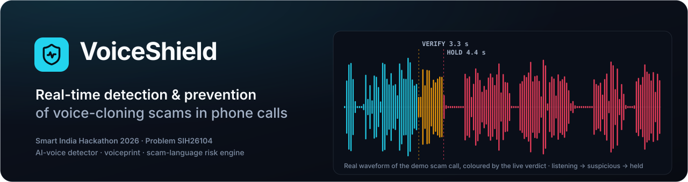

<br>


**[📖 Plain-language explainer](explain.md)** &nbsp;·&nbsp; **[🚀 Quick start](#-quick-start)** &nbsp;·&nbsp; **[🔬 Research report](docs/SIH26104_Research_and_Build_Plan.md)** &nbsp;·&nbsp; **[📄 Paper](docs/paper/voiceshield_paper.tex)** &nbsp;·&nbsp; **[📓 Notebooks](notebooks/)**

</div>

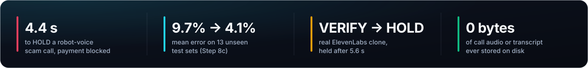

## 🛡️ What VoiceShield does

Voice cloning lets a scammer speak in the voice of a bank officer, a police officer or your own family member. VoiceShield **listens to the call while it happens** and decides **every second**:

<div align="center">

| | Verdict | What happens |
|:---:|---|---|
| 🟢 | **PASS** · authentic | Payments allowed, keep listening |
| 🟡 | **VERIFY** · suspicious | Confirm another way: an OTP to the customer's *own* phone, or a call-back on the official number |
| 🔴 | **HOLD** · likely spoofed | The bank app **blocks the payment automatically** and the security team is alerted |

</div>

It does this with **three independent checks** that cover for each other:

| | Check | Model | Catches |
|:---:|---|---|---|
| 🤖 | **AI-generated voice** | NII AntiDeepfake wav2vec 2.0 Large (frozen) + our **Step 8c** back-end on its 25 layers | Cloned and synthetic voices, even after noise suppression, Bluetooth or VoIP compression |
| 🧬 | **Voice ≠ claimed person** | WeSpeaker ResNet34 voiceprint vs. an enrolled customer | Human impersonators and clones of someone else |
| 💬 | **Scam language** | Whisper speech-to-text + 9 scam tactics in English, Hindi and Telugu | "Share the OTP", "account will be blocked", "digital arrest", "don't tell anyone"… |

> A matching voice never *lowers* the risk, and scam words from a genuine voice only ever reach VERIFY. HOLD needs a suspicious voice. Every alert explains itself in plain words.

---

## 🎬 See it in action

<div align="center">
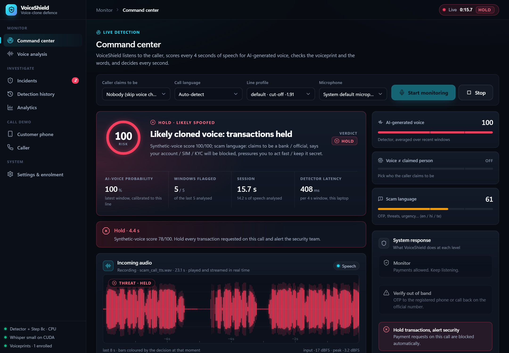
<sub><b>Command center</b>, a real run of the demo scam call. The robot voice reads a bank-fraud script and is <b>held after 4.4 s</b>. All four scam tactics are recognised, and the system response switches to “Hold transactions, alert security”.</sub>
</div>

<br>

<div align="center">
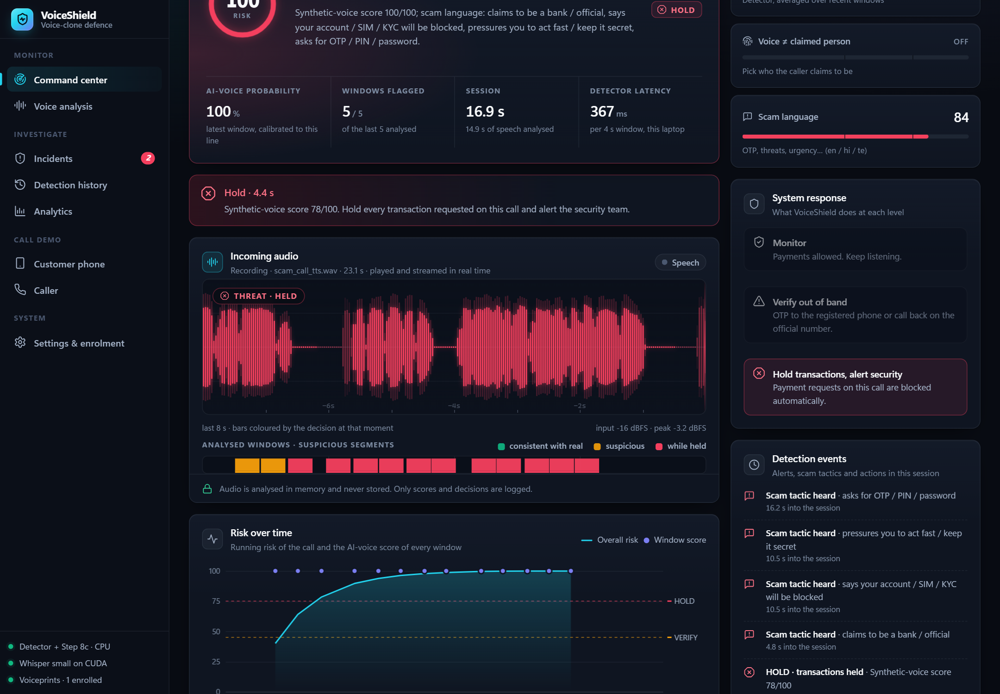
<sub>The <b>live waveform</b> is drawn from the exact audio sent to the detector. It turns cyan → amber → red as the verdict changes. Below it: every analysed 4-second window, the risk curve, and the event feed.</sub>
</div>

<br>

<table>
<tr>
<td width="50%">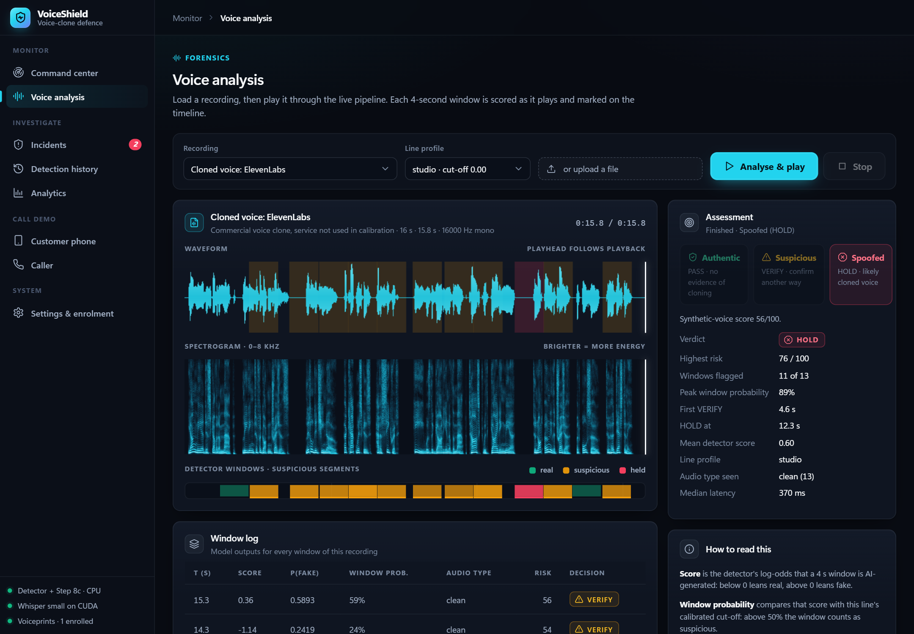<br><sub><b>🔍 Voice analysis</b>: waveform, spectrogram and per-window verdicts for a premium ElevenLabs clone. Assessment: <b>Spoofed</b>.</sub></td>
<td width="50%">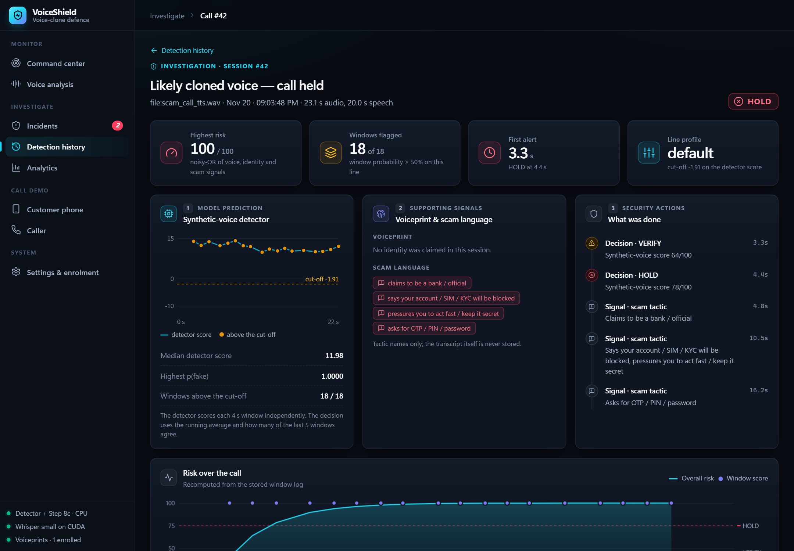<br><sub><b>🕵️ Investigation</b>: the evidence kept apart in three columns: <b>(1)</b> what the detector predicted, <b>(2)</b> supporting signals, <b>(3)</b> actions actually taken.</sub></td>
</tr>
<tr>
<td width="50%">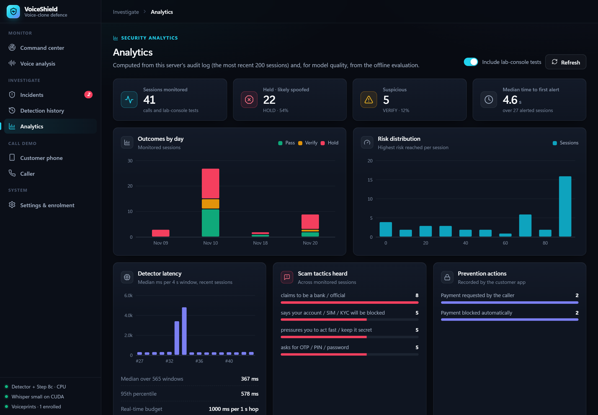<br><sub><b>📊 Analytics</b> from the real audit log (outcomes, risk distribution, latency, scam tactics), plus the offline model evaluation.</sub></td>
<td width="50%">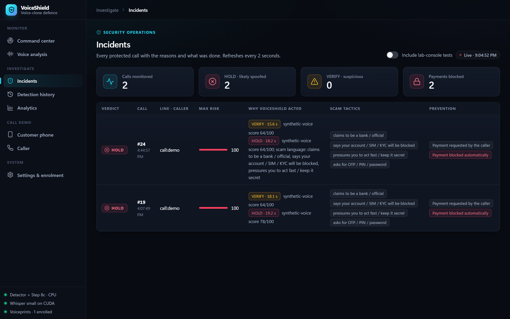<br><sub><b>🚨 Incidents</b>: the bank security team's live view. It refreshes every 2 s and pops up a notice on every new HOLD.</sub></td>
</tr>
<tr>
<td width="50%">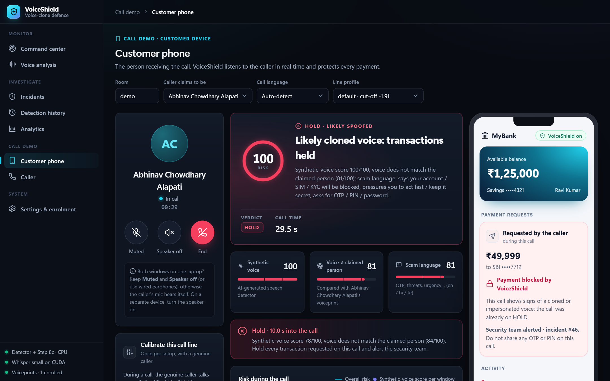<br><sub><b>📱 Customer phone</b> during the Step 9 attack: <b>HOLD</b>, and the bank app <b>blocks the ₹49,999 payment</b> automatically.</sub></td>
<td width="50%">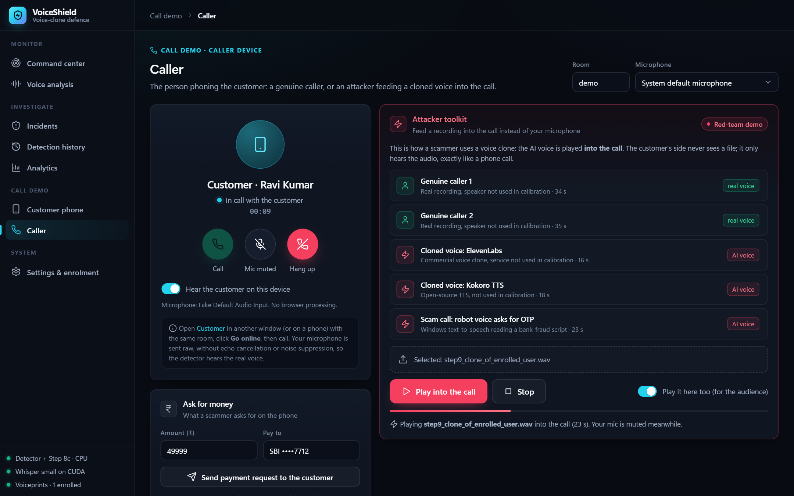<br><sub><b>☎️ Caller</b>: the attacker plays a clone of the enrolled person's own voice <i>into</i> the live call.</sub></td>
</tr>
</table>

<details>
<summary><b>📱 It also works at phone width</b></summary>
<br>
<div align="center">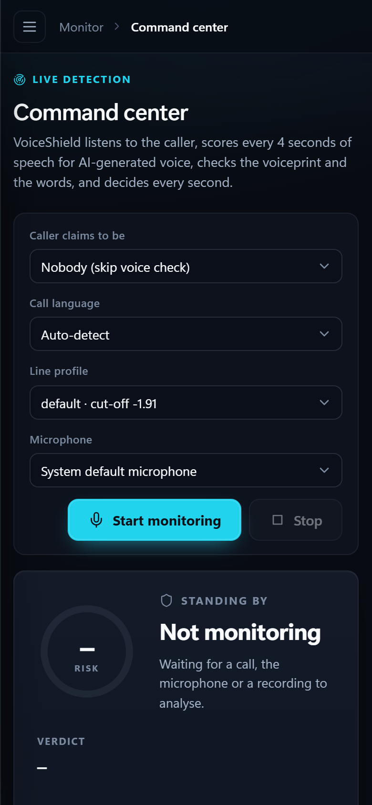</div>
</details>

---

## ⚙️ How it works

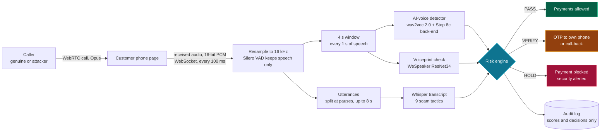

**One scam call, step by step**, as it happened in our end-to-end test:

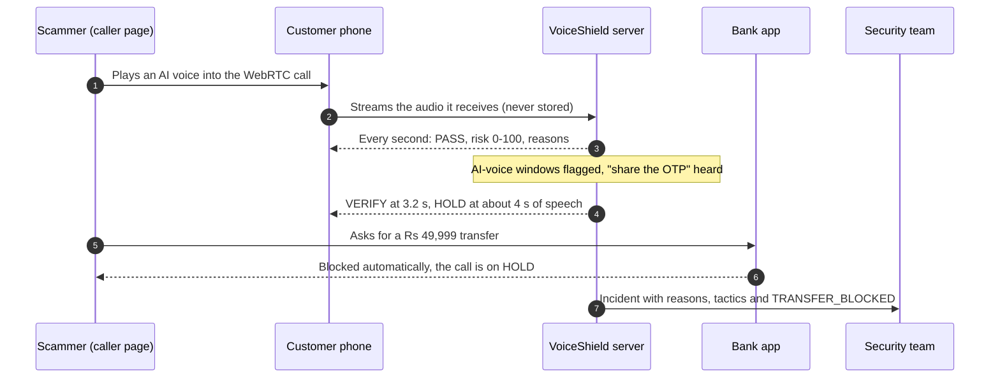

<details>
<summary><b>The decision rules (risk engine)</b></summary>

| Result | When |
|---|---|
| 🔴 **HOLD** | AI-voice risk ≥ 75 **and** 3 of the last 5 windows look fake |
| 🔴 **HOLD** | Scam language ≥ 50 **and** the voice or the identity was suspicious at any point in the call |
| 🟡 **VERIFY** | AI-voice risk ≥ 45, or 2 suspicious windows, or voiceprint mismatch ≥ 50, or scam language ≥ 50 |
| 🟢 **PASS** | None of the above |

- **Window score:** `s = σ(score − line cut-off)`. The AI-voice risk is a running average that starts at 0, so one odd window cannot raise an alarm.
- **Escalation only:** the verdict only goes up during a call, never back down.
- **Displayed risk:** the noisy-OR of the three signals.

</details>

---

## 🔬 Research highlights

### 1 · Everyday audio processing breaks deepfake detectors, and we repaired it without retraining

Phones, laptops, Bluetooth headsets and calling apps change the sound before anyone hears it. Noise suppression raised the detector's error on premium clones from **8% to 34%**, and WhatsApp-style **Opus** compression raised it to **45%**, close to a coin toss. **A scammer gets this disguise for free.**

Retraining made the detector *forget* real-world fakes, three times over. So in **Step 8c** we kept the detector **frozen** and trained a 1,050-number back-end that reads its internal layers instead:

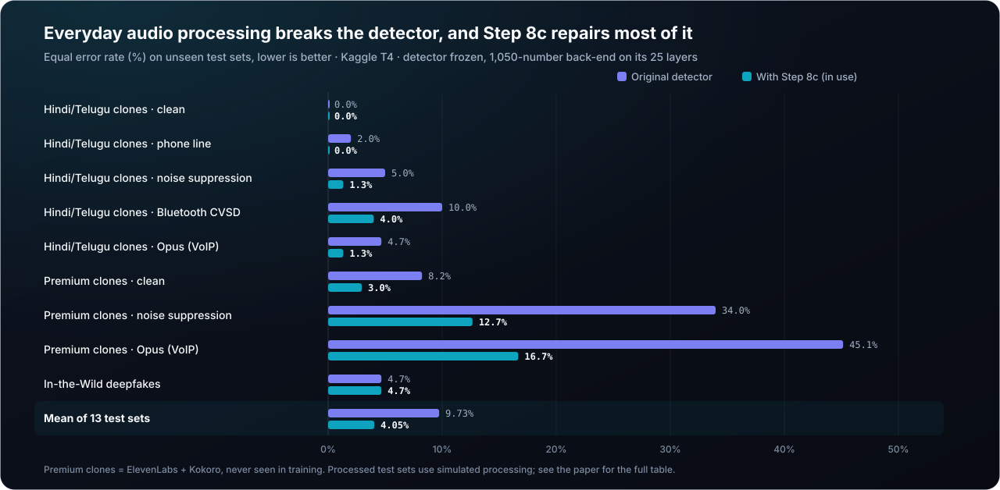

### 2 · The evidence is still inside the model

Simple probes on each of the detector's 25 layers show that the **middle layers keep the clues** that the final read-out loses after processing. The back-end learned to weight exactly those layers.

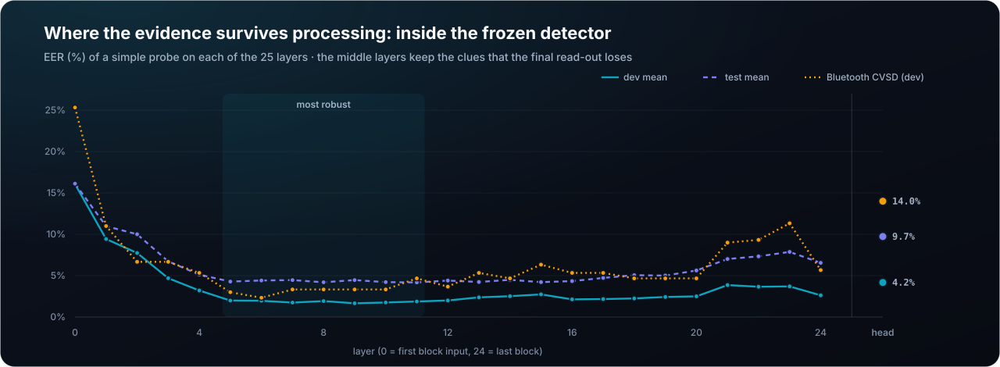

### 3 · Fine-tuning versus leaving the detector frozen

| Approach | Trained parameters | Dev mean EER (8 sets) | In-the-Wild dev | Outcome |
|---|---:|---:|---:|:---:|
| Original detector | – | 4.17% | 4.0% | baseline |
| LoRA fine-tuning (Step 8) | 3.54 M | 5.28% | **9.5%** | ❌ forgot |
| LoRA + teacher anchor (Step 8b) | 3.54 M | 5.79% | **8.3%** | ❌ forgot |
| **Frozen detector + layer back-end (Step 8c)** | **1,050** | **1.39%** | **1.75%** | ✅ adopted |

<sub>Development values at each method's best checkpoint. The unseen test sets tell the same story: the In-the-Wild test EER is unchanged at 4.67% with Step 8c.</sub>

### 4 · On real recordings, in the live server

| Recording | Original detector | With Step 8c |
|---|:---:|:---:|
| 🙋 Genuine callers 1 and 2 | 🟢 PASS | 🟢 PASS (lower risk) |
| 🤖 ElevenLabs clone | 🟡 VERIFY | 🔴 **HOLD at 5.6 s** |
| 🤖 Kokoro clone | 🟡 VERIFY | 🔴 **HOLD at 13.1 s** |
| 📞 Robot-voice scam call | 🔴 HOLD at 4.4 s | 🔴 HOLD at 4.4 s |
| 💻 Laptop mic, Windows enhancements ON | ❌ 2 false HOLDs | 🟡 1 VERIFY · ❌ 1 false HOLD |

<sub>Both detectors use their own `default` cut-off. The exported model reproduces the original detector's score to within 0.0003 and adds about 5% CPU time (about 340 ms per window). With the stricter <code>studio</code> profile the Kokoro clone stays at VERIFY. Windows audio enhancements must stay <b>off</b>.</sub>

### 5 · The hardest attack: a clone of the person the caller claims to be

We cloned the enrolled team member's **own voice** locally, with consent, from 2 minutes of that member's recordings (kNN-VC), made it read the bank-fraud script, and attacked the system while claiming to be that member:

| Caller (claims to be the enrolled person) | 🧬 Voiceprint (cut-off 0.45) | 🤖 AI-voice detector | Verdict |
|---|:---:|:---:|:---:|
| **Clone of the member's voice + scam script** | 0.41, *almost* accepted | **18 / 18** windows flagged | 🔴 **HOLD at 4.4 s** |
| … the same clone **through the live WebRTC call** (2 runs) | 0.32 | median score 13 | 🟡 VERIFY 3.8–4.5 s → 🔴 **HOLD 7.8–10 s**, ₹49,999 **blocked** |
| The member's real voice | 0.95, matches | 0 / 19 | 🟢 PASS |

> The voiceprint alone would nearly have let the clone through. The AI-voice detector caught every window, and that is exactly why VoiceShield never relies on one check. Still open: the same attack with a *premium* clone.

---

## 🗺️ The journey

| Step | What we did | Result |
|:---:|---|---|
| 0 | Our own spectrogram CNN and wav2vec 2.0 classifier | ❌ 33–37% error on new audio, so we start from a post-trained detector |
| 2 | Zero-shot test of two detectors | ✅ AntiDeepfake **4.0%** EER on In-the-Wild; a popular Hugging Face model **32–38%** |
| 3 | Same-speaker Hindi / Telugu clones (kNN-VC) | ✅ **0.0–0.1%** EER clean · 🔬 a phone line raises it to 5.2% |
| 4 | Full fine-tuning on 3,760 clips | ❌ forgot real-world fakes, so the original was kept |
| 5 | Live streaming server | ✅ a 4 s window every 1 s of speech, **0.33 s** per window on a laptop CPU |
| 6 | Voiceprint and scam-language fusion | ✅ robot-voice scam call **HOLD at 4.4 s** |
| 6b–d | Live microphone tests | 🔬 Windows enhancements cause false alarms · ChatGPT's voice **HOLD at 5.3 s**, the human reading the same script **PASS** |
| 7 | Two-party WebRTC call with a bank app | ✅ HOLD after about 4 s of speech, ₹49,999 transfer **blocked** |
| 8 | Consumer audio processing study | 🔬 noise suppression / Opus: premium-clone EER **8% → 34% / 45%** |
| 8 · 8b | LoRA fine-tuning, alone and with a teacher anchor | ❌ learned the processing, forgot In-the-Wild (4.0% → 9.5%) |
| **8c** | **Frozen detector + 25-layer back-end** | ✅ mean EER **9.7% → 4.1%**, nothing forgotten |
| **8d** | **Step 8c in the live server** | ✅ ElevenLabs clone **VERIFY → HOLD** |
| UI | Security-console redesign | ✅ live waveform, forensics, investigation, analytics |
| **9** | **Attack: a clone of the enrolled person's own voice** | ✅ the voiceprint nearly accepted it (0.41 vs 0.45), but the detector flagged **18/18** windows: **HOLD**, and ₹49,999 **blocked** through the live call |

<sub>✅ worked &nbsp;·&nbsp; ❌ tried and rejected (reported honestly) &nbsp;·&nbsp; 🔬 research finding. Every number comes from the <a href="docs/SIH26104_Research_and_Build_Plan.md">results log</a>.</sub>

---

## 🧰 Tech stack

| Layer | Technology |
|---|---|
| 🤖 Detector | NII AntiDeepfake wav2vec 2.0 Large (ONNX, CPU) + Step 8c back-end in NumPy |
| 🎙️ Speech gate | Silero VAD v5 |
| 🧬 Voiceprint | WeSpeaker ResNet34-LM (ONNX) with a NumPy filterbank |
| 💬 Speech-to-text | faster-whisper: `small` on the GPU, `base` on the CPU |
| 🖥️ Server | Python 3.12, FastAPI, WebSockets, ONNX Runtime, SQLite audit log |
| 🎨 Frontend | HTML, CSS and JavaScript, Web Audio and AudioWorklet, WebRTC, Canvas and SVG. No frameworks, works **offline** |
| 🧪 Training and research | Kaggle T4 GPUs, PyTorch, Transformers, PEFT. Every notebook is first tested on the CPU |
| ✅ Quality | 41 fast tests (stub models) + 9 real-model tests (pytest) |

---

## 🚀 Quick start

**Already set up? Double-click `START_VOICESHIELD.bat`** in this folder. It checks the laptop, starts the server and opens http://127.0.0.1:8000. Keep its window open; closing it stops VoiceShield.

First-time setup:

```bash
cd voiceshield
py -3.12 -m venv .venv
.venv\Scripts\python -m pip install -r requirements.txt
.venv\Scripts\python setup_models.py        # downloads the ONNX models (~2 GB, once)
.venv\Scripts\python run.py                 # then open http://127.0.0.1:8000
```

| Open | For |
|---|---|
| `http://127.0.0.1:8000/#/live` | 🎛️ Command center (microphone, demo calls, files) |
| `/customer` + `/caller` | 📞 The two-window call demo |
| `/#/incidents` | 🚨 Security team view |

> [!TIP]
> Before a live demo: turn **off** Windows audio enhancements, use the built-in or a wired microphone (not Bluetooth), and calibrate once from **Settings & enrolment**.

<sub>The Step 8c layer model (<code>voiceshield_layers.onnx</code>, 1.26 GB) comes from the Step 8c Kaggle notebook. Without it the server falls back to the original detector automatically. Full setup: <a href="voiceshield/README.md">voiceshield/README.md</a>.</sub>

---

## 📁 Repository

```text
VoiceShield/
├── explain.md                 the whole project in plain words
├── voiceshield/               the working system
│   ├── server/                FastAPI + WebSocket, models, risk engine, calibration, audit log
│   ├── static/                the console (7 views) and the call-demo pages
│   ├── tools/                 scoring, calibration, Step 8c comparison
│   ├── samples/               demo calls (CC BY 4.0)
│   └── tests/                 41 fast + 9 real-model tests
├── notebooks/                 Kaggle experiments, Steps 2–8c (+ CPU tests in build/)
├── docs/
│   ├── SIH26104_Research_and_Build_Plan.md   research report and full results log
│   ├── paper/voiceshield_paper.tex           the research paper
│   └── assets/                README graphics (make_readme_figures.py rebuilds the charts)
└── recordings/                result tables (CSV) from the experiments
```

---

## 🔒 Privacy and responsible use

- 🎧 **What is never stored:** call audio is analysed in memory and never written to disk. Transcripts are never logged either.
- 🗄️ **What is stored:** the audit log keeps only scores, decisions, the *names* of scam tactics and prevention events.
- 🧬 **Voiceprints:** stored as 256 numbers and deletable from the console.
- 💻 **Where it runs:** everything runs on the laptop, and nothing is sent to an outside service.
- 🧑‍⚖️ **A human decides:** VoiceShield warns and triggers bank-side checks.
- 📦 **Left out of this repository on purpose:** the large model files, our own voice recordings, enrolled voiceprints and the local audit log.

## 🚧 Limitations and roadmap

- [x] Real-time fusion of AI voice, voiceprint and scam language
- [x] Two-party call demo with automatic payment blocking
- [x] Detector repaired for consumer audio processing (Step 8c), live in the server
- [x] Attack test with a clone of the *enrolled* person's own voice through the call (open-source clone, Step 9)
- [ ] The same attack with a *premium* clone of the enrolled person
- [ ] Calibrate the call channel (`call` profile) with real callers
- [ ] Train with *real* device processing: Windows still causes one false alarm with enhancements on
- [ ] Detector on the GPU, and a real phone as the caller (HTTPS)

## 📚 Learn more

| | |
|---|---|
| 📖 [explain.md](explain.md) | Every step in plain words, with a glossary |
| 🔧 [voiceshield/README.md](voiceshield/README.md) | Install, run, screens, demo script, WebSocket protocol |
| 🔬 [Research report and results log](docs/SIH26104_Research_and_Build_Plan.md) | Every experiment with its numbers (Steps 2–8d) |
| 📄 [Research paper](docs/paper/voiceshield_paper.tex) | LaTeX source, compile on Overleaf |

## 📜 Licences and credits

- **Detector:** NII AntiDeepfake, CC BY-NC-SA 4.0.
- **Indian-language data:** IndicSynth (CC BY-NC 4.0) and Kathbath (CC BY 4.0).
- **Demo clips:** from `garystafford/deepfake-audio-detection` (CC BY 4.0).
- **Other tools:** Silero VAD (MIT), WeSpeaker, Whisper.

This project is for **non-commercial research and education** only. Built for the **Smart India Hackathon 2026** (problem statement SIH26104, AICTE Cyber Security Cell).
